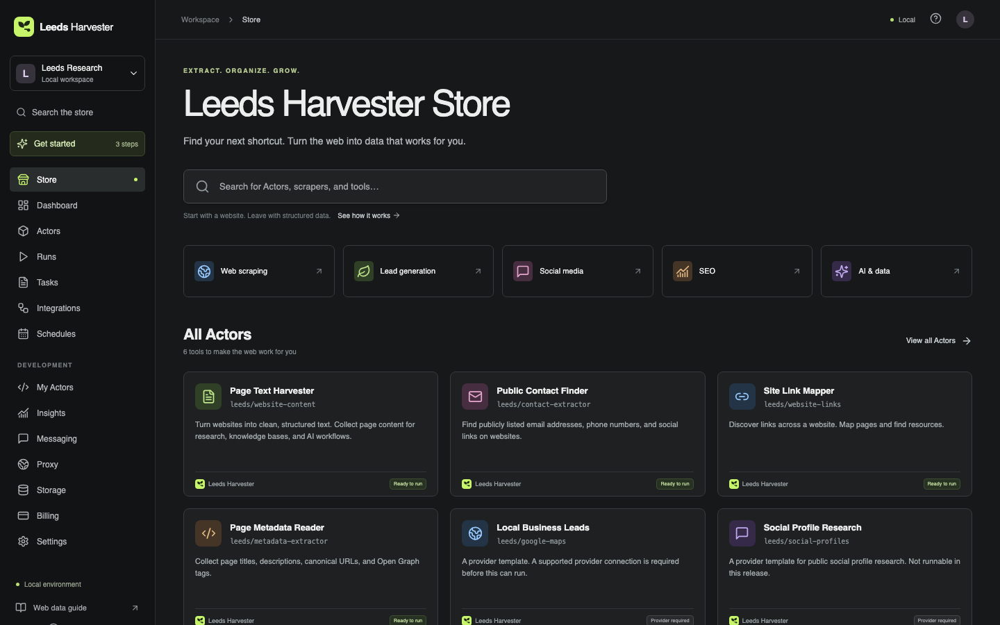
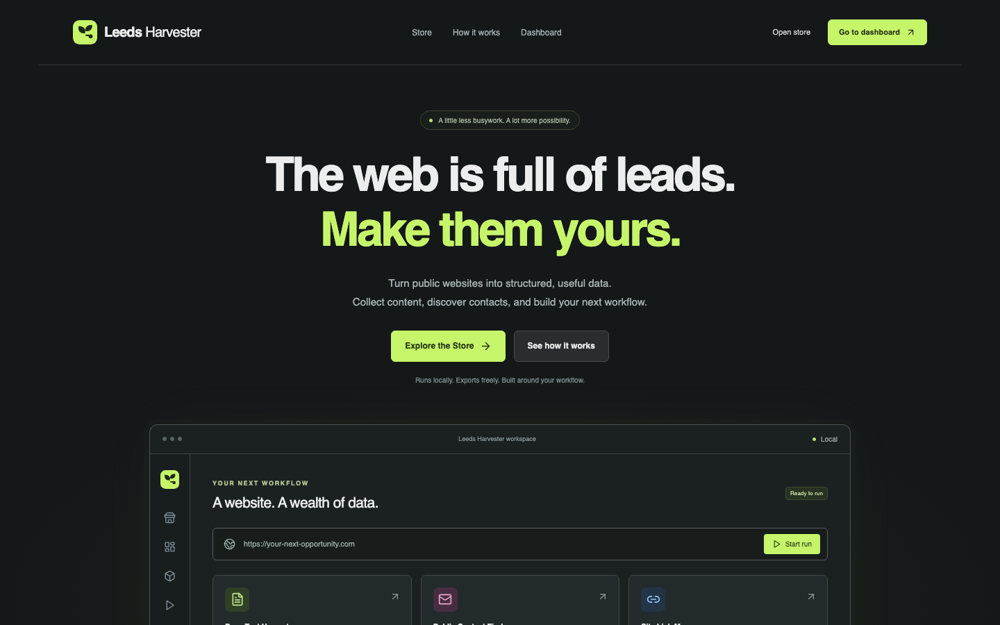
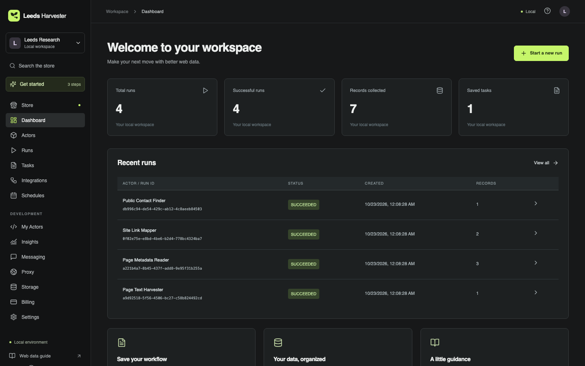
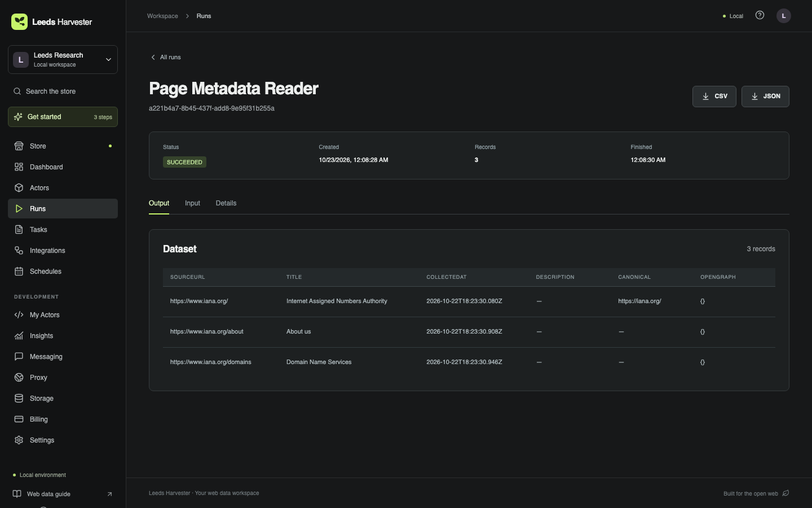

<p align="center">
  
</p>

<h1 align="center">Leeds Harvester</h1>

<p align="center">
  <strong>A self-hosted web scraping workspace.</strong><br>
  Turn public websites into structured data: page text, links, metadata and public contact details, with runs, saved tasks, cron schedules and JSON/CSV export.
</p>

<p align="center">
  
  
  
  
  <a href="LICENSE"></a>
  <a href="CONTRIBUTING.md"></a>
</p>



## Why Leeds Harvester

- **Open it and work.** No account or sign-in. The homepage leads straight to the Store and the dashboard.
- **Runs on your machine.** A Node.js server and a SQLite file. No cloud service, no API keys.
- **Real extraction, with sources.** Every record keeps its source URL and collection time.
- **Repeatable.** Save a run as a task and schedule it with interval or five-field cron (UTC) timing.
- **Export anywhere.** Download any dataset as JSON or CSV. CSV cells are protected against spreadsheet formula injection.

## Screenshots

| Homepage | Dashboard |
| --- | --- |
|  |  |

| Run results |
| --- |
|  |

## Built-in scrapers

| Scraper | Collects |
| --- | --- |
| **Page Text Harvester** | Clean page text for research, knowledge bases and AI workflows |
| **Public Contact Finder** | Publicly listed email addresses, phone links and social profile links |
| **Site Link Mapper** | Same-site link maps for discovering pages and resources |
| **Page Metadata Reader** | Titles, meta descriptions, canonical URLs and Open Graph tags |

Local Business Leads and Social Profile Research appear in the Store as provider templates. They need a data provider connection, which this release does not include, so they can't run.

## Quick start

Requires Node.js 24.15 or newer (built-in `node:sqlite`). The pinned version is in [`.nvmrc`](.nvmrc).

```sh
git clone https://github.com/KritishX/Leeds-Harvester.git
cd Leeds-Harvester
npm ci
npm run dev
```

Open <http://localhost:4180>. The homepage links to the Store and the dashboard.

Production mode serves the built frontend and the API from one process at <http://localhost:4181>:

```sh
npm test
npm run build
npm start
```

Data is stored in `data/leeds.sqlite`. Set `LEEDS_DATA_DIR` to keep it somewhere else, and `PORT` to change the server port.

## How it works

```text
React 19 + Vite UI  ──/api──▶  Node.js HTTP server  ──▶  SQLite (runs, tasks, schedules)
                                     │
                                     └──▶  Crawler: public-URL guard → pinned DNS → HTML parse (cheerio)
```

- **Runs:** at most two run at a time. Each run is limited to 20 pages, 60 seconds, 2 MB per page and 20 MB per run, with a queue of up to 20 pending runs.
- **Cancellation and restarts:** cancelled runs keep their partial results. Runs interrupted by a restart are marked as failed instead of being left running.
- **Schedules:** they only fire while the server is running.

See the [API contract](docs/api-contract.md) for every endpoint.

## Security model

Leeds Harvester has no sign-in, so it is designed to run on your own computer only:

- The server listens only on `127.0.0.1`, and it accepts only `localhost`/`127.0.0.1` Host headers, which blocks DNS-rebinding attacks.
- Every request that changes data must come from the app's own origin, so other websites can't make changes through your browser.
- The crawler only fetches public `http(s)` addresses on standard ports. It rejects private, loopback and reserved addresses, checks every DNS answer, connects only to the address it checked, and re-validates every redirect.
- Scraped HTML is parsed as data and never executed.

There is no sign-in, so **any program or user on the same computer can use the workspace**. Don't expose the port to a network. Before any shared deployment, add authentication, HTTPS and backups. The full model is in [docs/security-model.md](docs/security-model.md), and the checks that were run are in [docs/validation.md](docs/validation.md).

## Limitations

- It reads the HTML a server returns and doesn't run JavaScript. Pages that build their content in the browser, sites behind bot challenges, and pages that need a login may return incomplete results.
- IPv6-only websites are not supported.
- Integrations are saved preferences only. No webhook or third-party delivery happens.
- There is no billing, cloud execution, proxy pool or hosted publishing.

## Project layout

```text
server/   HTTP API, run queue, scheduler, crawler and catalog
src/      React application (single entry: main.tsx) and styles
tests/    node:test suites for the API, scheduler and extractors
docs/     API contract, security model, validation record and screenshots
.github/  CI workflow, issue forms and pull request template
```

## Contributing

Leeds Harvester is open source, and contributions are welcome: new scrapers, bug fixes, UI polish and documentation.

1. Read [CONTRIBUTING.md](CONTRIBUTING.md) for setup, the project layout and the rules that keep the crawler safe.
2. Find or open an [issue](https://github.com/KritishX/Leeds-Harvester/issues) describing the change.
3. Fork the repository, make your change with tests, and open a pull request. CI runs `npm test` and `npm run build`.

Please follow the [Code of Conduct](CODE_OF_CONDUCT.md). Report security vulnerabilities privately as described in [SECURITY.md](SECURITY.md).

## License

[MIT](LICENSE) © 2026 Kritish Dhital. You're free to use, modify and distribute Leeds Harvester, including commercially. Scrape responsibly: collect only public data, and respect each site's terms and applicable law.

## Credits

Designed and built by **Kritish Dhital**. The Leeds Harvester name and logo are original to this project. The console layout takes general inspiration from web-data marketplaces. No third-party code, assets or data are included. See [docs/reference-analysis.md](docs/reference-analysis.md) for how the reference was studied.
